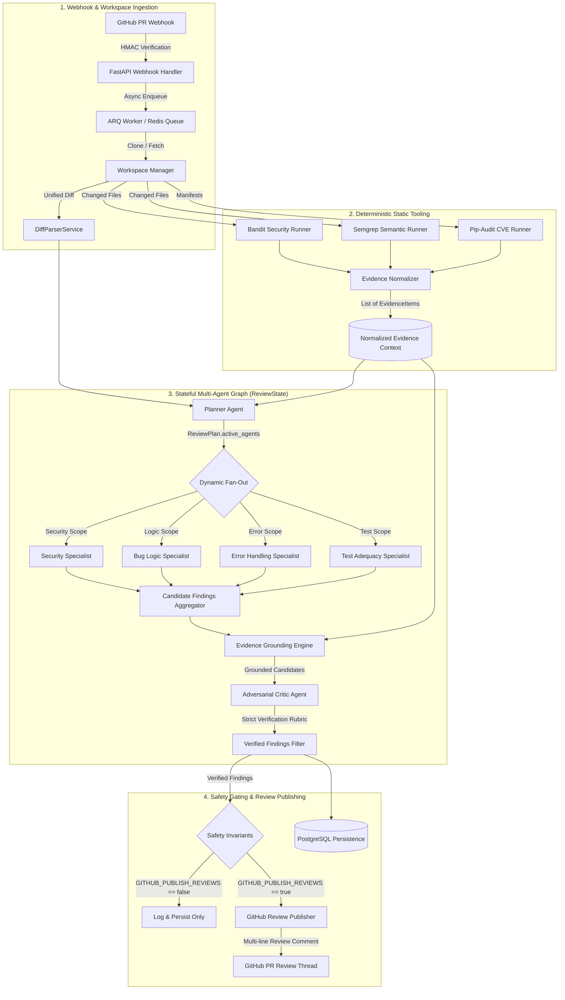
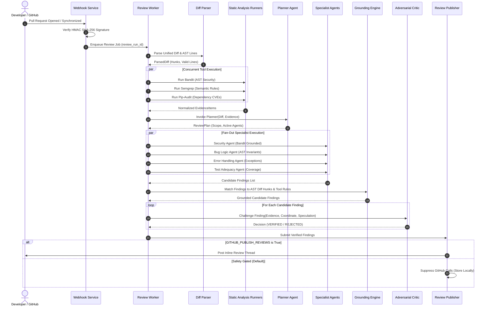
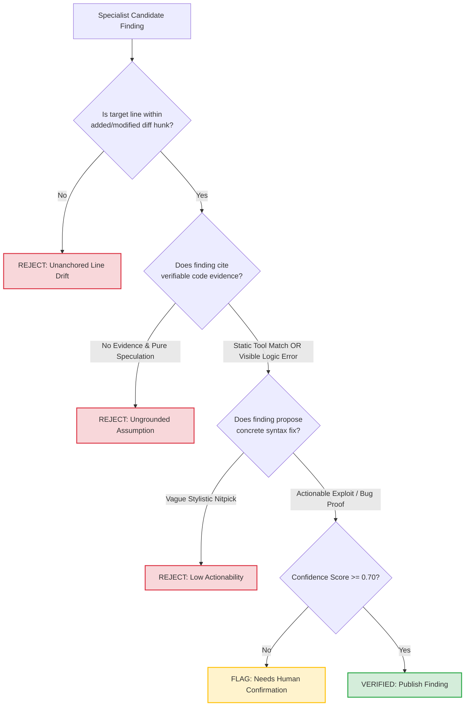

# Chapter 11: Figures and Tables Plan

**Project Title:** An Agentic AI Framework for Reliable and Evidence-Based Automated Code Review  
**Author:** Saksham Bhosale  
**Repository:** `D:\Projects\agentic-code-reviewer`  
**Execution Branch:** `feat/phase-7-evaluation`  

---

## 11.1 Figures Catalog and Specifications

This catalog provides reproducible, editable diagram specifications (in Mermaid.js and ASCII format) for every architectural, procedural, and empirical figure in the dissertation.

### Figure 1: Overall System Architecture
* **Placement:** Chapter 2 (Section 2.3) and Chapter 5 (Section 5.1).
* **Source Modules:** `backend/app/api/v1/webhooks.py`, `backend/app/services/diff_parser.py`, `backend/app/static_analysis/`, `backend/app/orchestration/review_graph.py`, `backend/app/services/github/review_publisher.py`.
* **Description:** Block diagram showing the end-to-end pipeline from incoming GitHub pull request webhook to final publication.

---

### Figure 2: Review Sequence and Agent Interaction Workflow
* **Placement:** Chapter 5 (Section 5.4).
* **Source Modules:** `backend/app/orchestration/review_graph.py`, `backend/app/agents/`.
* **Description:** UML sequence diagram illustrating asynchronous message flow across graph nodes.

---

### Figure 3: Adversarial Critic Verification Decision Tree
* **Placement:** Chapter 5 (Section 5.5) and Chapter 8 (Section 8.3).
* **Source Modules:** `backend/app/agents/critic.py`, `backend/app/prompts/critic.py`, `backend/app/schemas/verification.py`.
* **Description:** State decision tree utilized by the Critic Agent to evaluate candidate findings.

---

## 11.2 Tables Catalog and Data Sources

This catalog specifies all data tables in the dissertation, identifying their exact source run identifiers and files in `evaluation/results/`.

### Table 1: Benchmark Dataset Composition
* **Placement:** Chapter 4 (Section 4.1) and Chapter 7 (Section 7.1).
* **Source:** `evaluation/datasets/` directory manifests.
* **Content:** 23 cases (18 synthetic, 5 real-world open-source pull requests across 4 categories).

### Table 2: Comprehensive Five-Baseline Performance Comparison
* **Placement:** Chapter 1 (Executive Summary) and Chapter 7 (Section 7.2).
* **Sources:**
  - `evaluation/results/e130978a-1728-4f3e-903a-e58867070e9b/summary.json`
  - `evaluation/results/a1f820b7-c0ac-461e-a419-160919491cdc/summary.json`
  - `evaluation/results/d56531a3-3e3d-46cc-a0e1-240c6e4634c3/summary.json`
  - `evaluation/results/80467945-6c02-4f49-a2c9-f92cb8a23a9b/summary.json`
  - `evaluation/results/3b8d2539-07a3-40b5-9533-072b87debf93/summary.json`
* **Metrics:** Evaluated Cases (23), TP, FP, FN, Precision, Recall, F1-Score, False Discovery Rate (FDR), Relative FDR Reduction, Token Count, Operational Cost ($0.00).

### Table 3: Granular Category-Level Performance Breakdown
* **Placement:** Chapter 7 (Section 7.3).
* **Source:** `summary.json` under `category_breakdown` for each run identifier.
* **Content:** True Positives, False Positives, False Negatives, Precision, Recall, and F1 across BUG_LOGIC, ERROR_HANDLING, SECURITY, and TEST_ADEQUACY.

### Table 4: Real-World Pull Request Performance (Generalization Test)
* **Placement:** Chapter 7 (Section 7.5).
* **Source:** `cases.json` for cases starting with `REAL-` (`REAL-BUG-001`, `REAL-ERR-001`, `REAL-SEC-001`, `REAL-SEC-002`, `REAL-TEST-001`).
* **Content:** Granular case-by-case comparison between Static Only, Single-LLM Reviewer, and Full Agentic Framework.

### Table 5: Resource Telemetry and Latency Boundaries
* **Placement:** Chapter 7 (Section 7.6) and Chapter 8 (Section 8.4).
* **Source:** `summary.json` under `resource_usage` for each run.
* **Content:** API calls, Prompt Tokens, Completion Tokens, Total Tokens, Recorded Latency, and Latency Measurement Boundary (Neural Generation vs. Algorithmic Filter).
